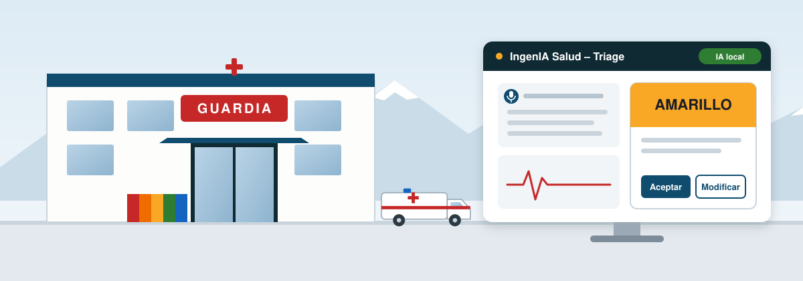

<h1 align="center">🏥 IngenIA Salud – Triage</h1>

<p align="center">
  
</p>

<p align="center">
  <b>Módulo de Triage Asistido por Inteligencia Artificial</b><br>
  Guardia Central · Hospital Regional Río Grande · Proyecto IngenIA Salud TDF
</p>

<p align="center">
  
  
  
  
  
  
</p>

Prototipo académico de **Prácticas Profesionalizantes II** (Tecnicatura Superior en Ciencia de Datos e Inteligencia Artificial – Centro Politécnico Superior Malvinas Argentinas). Es un copiloto para el box de triage: ordena el relato del paciente, controla que los datos estén completos y sugiere un color con su justificación. **El sistema propone y el profesional decide.**

> [!IMPORTANT]
> Prototipo en evaluación. Funciona **solo con casos ficticios**, todo el procesamiento ocurre en la propia PC y las reglas de color son provisorias hasta contar con las guías oficiales y la aprobación del HRRG.

---

## 📑 Contenido

1. [🩺 El problema](#-el-problema)
2. [⚙️ Cómo funciona](#️-cómo-funciona)
3. [✅ Qué incluye el prototipo](#-qué-incluye-el-prototipo)
4. [👥 Roles de usuario](#-roles-de-usuario)
5. [💻 Instalación](#-instalación)
6. [🧱 Arquitectura y tecnologías](#-arquitectura-y-tecnologías)
7. [🗂️ Estructura del repositorio](#️-estructura-del-repositorio)
8. [🔒 Datos y seguridad](#-datos-y-seguridad)
9. [📆 Avance por sprint](#-avance-por-sprint)
10. [🚧 Limitaciones y trabajo futuro](#-limitaciones-y-trabajo-futuro)
11. [📚 Documentación](#-documentación)
12. [🤝 Equipo](#-equipo)

---

## 🩺 El problema

En el box de triage de la Guardia Central, enfermería escucha el motivo de consulta, registra seis signos vitales (temperatura, frecuencia cardíaca, saturación, tensión arterial sistólica y diastólica, y frecuencia respiratoria) y asigna un color según reglas internas y su experiencia. Todo ocurre en pocos minutos y bajo presión, lo que genera demoras, datos incompletos y diferencias de criterio entre turnos. En la visita del 19/10/2026 el hospital pidió un triage **más intuitivo** y con **trazabilidad de las reevaluaciones**.

---

## ⚙️ Cómo funciona

```text
 Relato del paciente        Signos vitales           Sugerencia               Decisión
 (dictado o escrito)  ──►   (los carga          ──►  color + motivos     ──►  del profesional
        │                   enfermería)              + datos faltantes        aceptar / modificar /
        ▼                                                  ▲                  rechazar (con motivo)
 MedGemma local ordena      Reglas de seguridad ───────────┘                        │
 el relato en campos        (fijan un color mínimo)                                 ▼
                                                                            Registro y En espera
                                                                            (reevaluación con reloj)
```

- **La IA no decide el color.** MedGemma solo estructura el relato (motivo, localización, duración, síntomas). Los signos vitales, el dolor y las banderas rojas los carga enfermería.
- **Las reglas fijan un piso.** Si un valor es crítico, el sistema nunca sugiere un color menor.
- **El profesional confirma.** Si modifica o rechaza la sugerencia, el motivo es obligatorio y queda registrado.
- **Si la IA no responde**, el triage sigue de forma manual.

---

## ✅ Qué incluye el prototipo

| Área | Funcionalidad |
|---|---|
| 🔐 Acceso | Inicio de sesión con roles, bloqueo por intentos fallidos, clave temporal y cambio obligatorio de contraseña |
| 🎙️ Ingreso | Relato escrito o **dictado por voz** con Whisper local, y extracción de datos con MedGemma |
| 🩺 Evaluación | Carga de signos vitales con avisos de valores fuera de rango y controles de datos faltantes |
| 🎨 Sugerencia | Tarjeta con color, motivos, fuente y qué datos harían subir la prioridad |
| 🔁 En espera | Lista de pacientes, búsqueda por código de episodio o DNI, reevaluación con reloj por color |
| 💬 Consulta | Chat con MedGemma sobre el caso, sin diagnósticos ni indicaciones de tratamiento |
| 📜 Auditoría | Historial completo por episodio, filtros por fecha y estado, exportación a Excel o PDF sin DNI |
| 🛠️ Administración | Alta de cuentas, roles, desbloqueo y claves temporales, con registro de cada acción |
| 📦 Distribución | Instalador de Windows **sin internet** que incluye la app, Ollama y los modelos |

---

## 👥 Roles de usuario

| Rol | Puede | No puede |
|---|---|---|
| **Enfermería** | Cargar casos, ver sugerencias, decidir y reevaluar | Gestionar cuentas |
| **Médico** | Lo mismo que enfermería | Gestionar cuentas |
| **Auditor** | Consultar historial, DNI y exportar (pide su contraseña) | Modificar datos |
| **Jefatura de Guardia** | Cargar, probar, activar y desactivar las reglas del hospital (`reglas.html`) | Atender pacientes |
| **Administrador** | Gestionar cuentas y contraseñas | Atender pacientes |

---

## 💻 Instalación

### A · Usuario final: instalador offline

El instalador `Instalador_IngenIA_Salud_Triage_0.1.0.exe` (unos 6 GB, junto con sus archivos `.bin`) instala todo con doble clic, **sin Python, sin Ollama previo y sin internet**. Crea un acceso directo en el escritorio y, en el primer inicio, pide crear la cuenta de administrador.

📘 Paso a paso para personal no técnico: **Manual de instalación** (carpeta del proyecto en Drive).
🔧 Cómo se construye el instalador: [`empaquetado/LEEME.md`](empaquetado/LEEME.md).

### B · Desarrollo

<details>
<summary><b>Requisitos</b></summary>

<br>

| Necesario | Detalle |
|---|---|
| 🪟 Windows 10/11 o Linux | Probado en Windows con PowerShell |
| 🐍 Python | 3.11 o superior |
| 🦙 Ollama | Con los modelos `medgemma:4b`, `embeddinggemma` y `qwen2.5:0.5b` |
| 🌐 Navegador | Chrome o Edge actualizados (el dictado necesita micrófono) |

```powershell
ollama pull medgemma:4b
ollama pull embeddinggemma
ollama pull qwen2.5:0.5b
```

</details>

Desde la raíz del repositorio:

```powershell
cd backend
python -m venv .venv
.\.venv\Scripts\Activate.ps1
python -m pip install -r requirements.txt

# Claves de cifrado del DNI (solo la primera vez)
python scripts/preparar_identificacion.py

# Primera cuenta y rol administrador (solo la primera vez)
python -m flask --app app crear-profesional
python -m flask --app app asignar-rol --rol admin

# Iniciar con la extracción real de MedGemma
$env:HRRG_MODO_EXTRACCION = "ia"
python app.py
```

Abrir **http://127.0.0.1:5000/** y detener con <kbd>Ctrl</kbd> + <kbd>C</kbd>.

> [!NOTE]
> Sin la variable `HRRG_MODO_EXTRACCION=ia`, la app usa casos simulados: sirve para probar el flujo sin Ollama.

<details>
<summary><b>Variables de entorno opcionales</b></summary>

<br>

| Variable | Para qué | Valor por defecto |
|---|---|---|
| `HRRG_MODO_EXTRACCION` | `ia` usa MedGemma; `simulado` usa casos de prueba | `simulado` |
| `MEDGEMMA_MODELO` | Modelo de Ollama | `medgemma:4b` |
| `OLLAMA_HOST` | Dirección del servidor de Ollama | `http://localhost:11434` |
| `WHISPER_MODELO` | Tamaño del modelo de voz (`tiny`, `base`, `small`, `medium`) | `small` |
| `WHISPER_HILOS` / `MEDGEMMA_HILOS` | Reparto de la CPU entre voz e IA en PCs sin GPU | automático |

</details>

<details>
<summary><b>Pruebas automáticas</b></summary>

<br>

```powershell
cd backend
python -m pytest -q tests
```

</details>

---

## 🧱 Arquitectura y tecnologías

| Capa | Tecnología | Función |
|---|---|---|
| Interfaz | HTML, CSS y JavaScript | Pantallas de ingreso, sugerencia, En espera, auditoría y administración |
| Servidor | Flask 3 (waitress en el instalador) | API, sesiones, roles y validaciones |
| Datos | Pydantic y SQLite | Esquema único de campos, episodios, eventos y cuentas |
| IA | MedGemma 4B en Ollama | Extracción del relato y chat sobre el caso |
| Voz | faster-whisper (local) | Dictado por voz sin enviar audio fuera de la PC |
| Búsqueda documental | ChromaDB + embeddinggemma | Base para el RAG con guías (pendiente de guías oficiales) |
| Seguridad | Hash de contraseñas, Fernet | Cuentas y DNI cifrado |
| Distribución | PyInstaller + Inno Setup | Instalador offline para Windows |

---

## 🗂️ Estructura del repositorio

```text
HRRG---PP2/
├── backend/
│   ├── app.py              # aplicación Flask y rutas
│   ├── ia/                 # MedGemma, chat, dictado (Whisper) y trazabilidad
│   ├── src/                # esquemas, validación, reglas, auth, admin, registro, cifrado, exportación
│   ├── datos/              # casos simulados y esquemas JSON
│   ├── evaluacion/         # métricas de extracción
│   ├── scripts/            # preparación de claves y pruebas de IA y voz
│   ├── tests/              # pruebas automáticas (pytest)
│   └── docs/               # diccionario de datos, controles y guion de demo
├── frontend/               # pantallas, estilos y JavaScript
├── empaquetado/            # instalador offline (PyInstaller + Inno Setup)
├── docs/                   # contrato de API, políticas y portada
└── README.md
```

---

## 🔒 Datos y seguridad

- **Sin datos reales.** El prototipo se prueba con casos ficticios; el repositorio no contiene datos de pacientes ni pesos de modelos.
- **Todo local.** El relato, el audio y la IA se procesan en la PC, sin servicios en la nube (Leyes 25.326 y 26.529).
- **DNI cifrado** y búsqueda por huella, con claves guardadas fuera del repositorio (`~/.hrrg_pp2_claves/`).
- **Archivos locales** (no se suben a GitHub): cuentas, episodios, clave de sesión y registros en `~/.hrrg_pp2/`.
- **Trazabilidad.** Cada extracción, corrección, decisión y exportación queda registrada con usuario y hora.

---

## 📆 Avance por sprint

| Sprint | Período | Resultado |
|---|---|---|
| **1 · Planificación** | 28/09 – 04/10 | Equipo, roles, ámbito de desarrollo, carta de presentación y análisis del problema |
| **2 · Desarrollo** | 05/10 – 25/10 | Prototipo funcional de punta a punta, visita a la guardia e instalador offline (31 de 39 tareas) |
| **3 · Cierre** | 26/10 – 01/11 | Manuales, documento de escalabilidad, informe final, presentación y entrega |

---

## 🚧 Limitaciones y trabajo futuro

- **Guías oficiales:** las reglas de color son provisorias. El RAG y el motor clínico se activan cuando el HRRG entregue y autorice las guías y sus reglas internas.
- **Validación clínica:** no se reportan métricas clínicas (concordancia, subtriage) hasta evaluar con referentes del hospital.
- **Escala:** hoy corre en una PC. Para varios puestos se instala en un servidor de la red interna (ver documento de escalabilidad).
- **Integraciones:** la conexión con la historia clínica y la mesa de entrada queda para una próxima versión.

---

## 📚 Documentación

| Documento | Ubicación |
|---|---|
| **Manual de usuario** | [`docs/manual_usuario.md`](docs/manual_usuario.md) |
| Contrato de API | [`docs/contrato_api.md`](docs/contrato_api.md) |
| Diccionario de datos V2 | [`backend/docs/diccionario_datos_v2.md`](backend/docs/diccionario_datos_v2.md) |
| Controles de validación | [`backend/docs/controles_validacion.md`](backend/docs/controles_validacion.md) |
| Configuración de la IA | [`backend/docs/configuracion_ia.md`](backend/docs/configuracion_ia.md) |
| Identificación cifrada | [`docs/identificacion_cifrada.md`](docs/identificacion_cifrada.md) |
| Política de registros | [`docs/politica_registros.md`](docs/politica_registros.md) |
| Guion de la demo | [`docs/guion_demo.md`](docs/guion_demo.md) |
| Empaquetado | [`empaquetado/LEEME.md`](empaquetado/LEEME.md) |
| Manual de instalación, minutas y retrospectivas | Carpeta del proyecto en Google Drive |

---

## 🤝 Equipo

**Equipo N1 – HRRG – PP2 2C 2026**

| Integrante | Área en el Sprint 2 |
|---|---|
| Darío Martínez | Datos y calidad: diccionario, esquemas, casos de prueba y métricas |
| Maricel Rausch | Backend e integración |
| Tomás Alderete | Inteligencia artificial: MedGemma y RAG |
| Bárbara Rigoni | Frontend e interfaz |

Referente del HRRG: Esp. Bioing. Juan Francisco Navoni.

---

<p align="center">
  <sub>Equipo N1 · Prácticas Profesionalizantes II · Centro Politécnico Superior Malvinas Argentinas · Proyecto IngenIA Salud TDF · 2026</sub>
</p>
