# Manual de usuario · Triage asistido por IA

**Hospital Regional Río Grande (HRRG) · Equipo 1 · Prácticas Profesionalizantes II**
**Versión:** prototipo local · **Actualizado:** 30/10/2026

> **Importante.** Es un **prototipo**. Usá solo **datos ficticios**: nada de nombres, domicilios, teléfonos ni casos reales.
> El color que propone el sistema sale de **reglas de referencia del Sistema Manchester y adaptaciones locales, todavía sin validar** por Enfermería y Guardia del HRRG.
> **La decisión final es siempre del profesional.**

---

## Índice

1. [Qué hace el sistema](#1-qué-hace-el-sistema)
2. [Perfiles: quién puede hacer qué](#2-perfiles-quién-puede-hacer-qué)
3. [Ingresar al sistema](#3-ingresar-al-sistema)
4. [Triage paso a paso (Enfermería y Médico/a)](#4-triage-paso-a-paso-enfermería-y-médicoa)
5. [Pacientes en espera](#5-pacientes-en-espera)
6. [Lista de espera en la sala y en el celular](#6-lista-de-espera-en-la-sala-y-en-el-celular)
7. [Auditoría](#7-auditoría)
8. [Reglas del hospital (Jefatura de Guardia)](#8-reglas-del-hospital-jefatura-de-guardia)
9. [Administración de usuarios](#9-administración-de-usuarios)
10. [Colores y tiempos de referencia](#10-colores-y-tiempos-de-referencia)
11. [Problemas frecuentes](#11-problemas-frecuentes)

---

## 1. Qué hace el sistema

Ayuda a ordenar la atención en la guardia:

1. El profesional escribe o dicta **lo que cuenta el paciente**.
2. La IA, que corre en la misma computadora (MedGemma), **saca los datos del relato**: motivo, desde cuándo, dónde duele y síntomas.
3. El profesional **revisa esos datos** y **carga los signos vitales**.
4. El sistema **sugiere un color de prioridad** y explica por qué.
5. El profesional **acepta, modifica o rechaza** la sugerencia. Todo queda registrado a su nombre.
6. El paciente pasa a **En espera**, con un reloj que avisa cuándo hay que reevaluarlo.

**Indicadores del encabezado:**

| Indicador | Qué significa |
|---|---|
| `enfermeria · Nombre · sesión del servidor` | Quién está usando el sistema. **Salir** cierra la sesión. |
| **MODO SIMULADO** / **IA LOCAL · RESTO SIMULADO** | Si la extracción la hace MedGemma (IA local) o una simulación con casos de ejemplo. |
| Banda amarilla | Recordatorio permanente: datos ficticios, la sugerencia es de demostración. |

---

## 2. Perfiles: quién puede hacer qué

| Perfil | Puede | No puede |
|---|---|---|
| **Enfermería** | Cargar casos, pedir la sugerencia, decidir el color, reevaluar, escalar a ROJO, finalizar | Exportar ni administrar usuarios |
| **Médico/a** | Lo mismo que Enfermería | Exportar ni administrar usuarios |
| **Auditoría** | Ver En espera, el historial completo de cada caso y el DNI; buscar por DNI; ver todos los casos (incluidos los finalizados); **exportar** a Excel o PDF; ver las reglas del hospital | Cargar, modificar ni decidir nada (**solo lectura**) |
| **Jefatura de Guardia** | Cargar, probar, activar, desactivar y editar las **reglas del hospital** | Atender pacientes ni ver casos |
| **Administración** | Crear usuarios, asignar perfiles, desbloquear cuentas, generar claves temporales | Ver casos de pacientes |

---

## 3. Ingresar al sistema

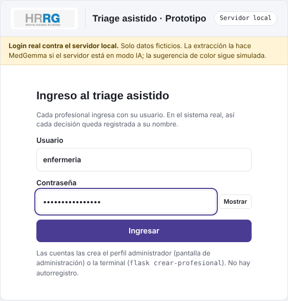

1. Escribí tu **usuario** y tu **contraseña**.
2. Con el botón **Mostrar** ves lo que estás escribiendo. **Ocultar** lo vuelve a tapar.
3. Tocá **Ingresar**.

**Clave temporal o contraseña vencida:** el sistema te lleva a **Cambiar contraseña** antes de seguir.

**Reglas de la contraseña:**
- Mínimo **12 caracteres**, con mayúscula, minúscula, número y símbolo.
- **Vence cada 90 días** y no se puede repetir ninguna de las últimas 5.
- Después de **5 intentos fallidos**, la cuenta se bloquea y la tiene que desbloquear Administración.

**Después de ingresar:**
- Enfermería y Médico/a empiezan en **1 · Ingreso**.
- Auditoría empieza en **En espera**.
- Administración entra a **Gestión de accesos**.
- Jefatura de Guardia entra a **Reglas del hospital**.
- Al empezar, el cuadro del relato está **vacío**: solo muestra un ejemplo en gris.

**Cierre de sesión por inactividad:**
- Si pasan **15 minutos sin usar el sistema**, la sesión se cierra sola. Es para que nadie use tu usuario si te alejás de la computadora.
- **1 minuto antes** aparece un aviso abajo, con una cuenta regresiva. Para seguir, tocá **Seguir conectado** o simplemente mové el mouse o escribí algo.
- Las listas que se actualizan solas (En espera, la pantalla del celular) **no** cuentan como uso.
- Si se cerró, el ingreso muestra *"La sesión se cerró por inactividad"*. Volvé a entrar.

---

## 4. Triage paso a paso (Enfermería y Médico/a)

Arriba se ve en qué paso estás: **1 Ingreso › 2 Medición › 3 Sugerencia**.

### Paso 1 · Ingreso (relato)

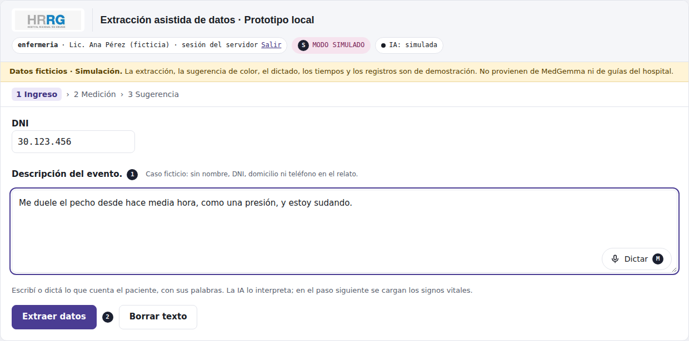

1. **DNI** (opcional): sirve para juntar todas las atenciones de la misma persona.
   - El DNI **se guarda cifrado** y **nunca se manda a la IA**.
   - Si no lo cargás, el caso queda como "Sin DNI".
   - Con **Enter** se valida el DNI y pasás directo al relato.
2. **Condición especial** (opcional), al lado del DNI: *Policial, Judicial, Custodia policial, Violencia, Accidente laboral, Salud mental* u *Otra*.
   - Es un dato **administrativo o legal**, aparte de la prioridad clínica (recomendación del HRRG): **no cambia el color**, **no se manda a la IA** y **no la usan las reglas**.
   - Se ve en En espera, en la vista del personal de la sala, en el resumen, en la exportación del auditor y en la API del hospital.
3. **Descripción del evento:** lo que cuenta el paciente o su acompañante, **con sus palabras**. Por ejemplo: *"Me duele el pecho desde hace media hora, como una presión, y estoy sudando."*
   - Con **Dictar** se transcribe la voz al cuadro. Después se puede corregir a mano.
   - Si el relato tiene un DNI o un teléfono, el sistema **avisa y no lo manda a la IA**. Hay que sacarlo con **Quitar dato y continuar**.
4. Tocá **Extraer datos**.
   - Mientras procesa, el botón queda bloqueado y arriba aparece **"Consultando al servidor…"**.
   - Con MedGemma, la primera vez puede tardar **1 o 2 minutos**.
   - Si algo falla, **el texto no se pierde**.
5. **Borrar texto** limpia solo el cuadro del relato.

### Paso 2 · Medición

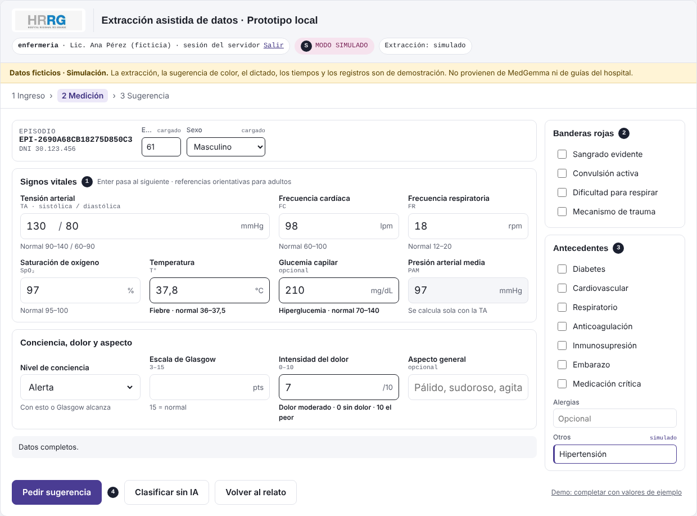

1. **Revisá lo que sacó la IA.** Cada dato tiene una etiqueta que dice de dónde salió:
   - *IA* o *simulado*: lo sacó la IA (o la simulación).
   - *corregido*: lo cambiaste vos.
   - *cargado*: lo completaste vos.
   - *medido*: es un signo vital.
   - *falta*: no estaba en el relato.

   **Lo que el paciente no dijo queda vacío, nunca en cero.**
   - El relato ya no se repite en esta pantalla: quedó en el paso 1.
2. Completá **edad** y **sexo**. Si el relato los dice (*"tengo 27 años"*, *"soy mujer"*), ya vienen cargados y marcados para revisar.
3. **Signos vitales** (①): TA, FC, FR, SpO₂, temperatura y glucemia (opcional).
   - **Enter** pasa al campo siguiente.
   - La **PAM** se calcula sola.
   - Debajo de cada campo está el valor normal de referencia para adultos.
   - **Borde oscuro** = valor fuera de lo normal. **Rojo** = valor crítico o imposible: hay que corregirlo para seguir.
4. **Conciencia, dolor y aspecto:**
   - Para la conciencia, alcanza con el **nivel de conciencia** *o* el **Glasgow**.
   - El **dolor** va de 0 a 10.
5. **Banderas rojas** (②) y **Antecedentes** (③): se marcan con un toque. Lo que el paciente mencionó ya viene marcado (por ejemplo *"sangra"*, *"soy diabética"*), salvo que lo haya negado (*"sin sangrado"*). Revisalo siempre.
6. Abajo se avisa si **faltan datos**. Si faltan **3 o más signos vitales**, el sistema no sugiere color.
7. Los botones:
   - **Pedir sugerencia** (④): pasa al paso 3.
   - **Clasificar sin IA**: elegís el color a mano. Está siempre disponible, por si la IA no anda.
   - **Volver al relato**: vuelve al paso 1.

### Después de decidir: pantalla en blanco

Una vez que registraste la decisión (**Aceptar**, **Modificar** o **Rechazar**), el caso queda cerrado y pasa a **En espera**. Si después volvés a **Ingreso** o a **Medición**, la pantalla aparece **en blanco**, lista para el próximo paciente. Para cambiar algo de ese paciente, usá **Reevaluar** desde En espera.

### Paso 3 · Sugerencia y decisión

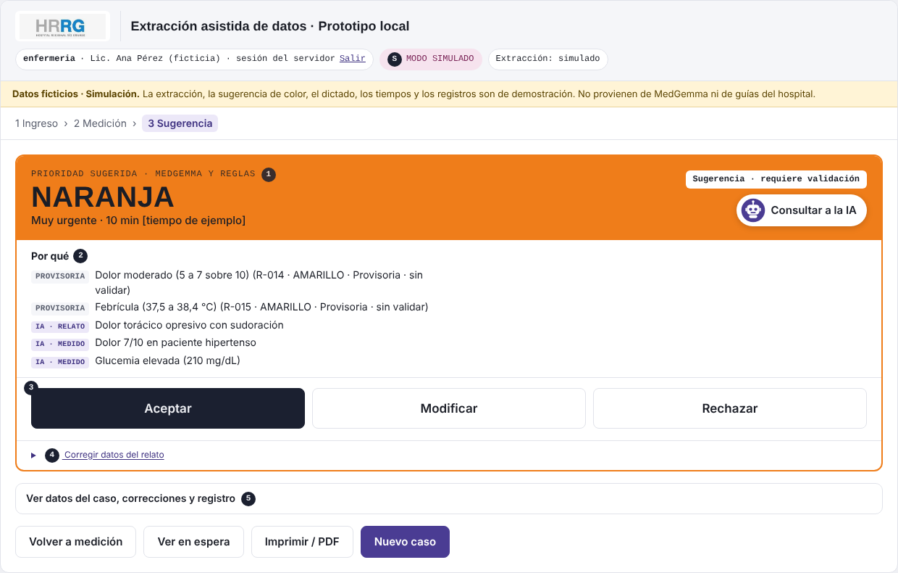

1. **Color sugerido** (①), con su tiempo de referencia.
2. **Por qué** (②): la explicación en palabras clínicas. Cada línea dice de dónde sale:
   - **HRRG**: una regla de la lista que administra la Jefatura de Guardia, con su código (por ejemplo R-001) y su origen: Sistema Manchester, adaptación local o provisoria.
   - **REGLA**: la copia de respaldo de las reglas de ejemplo (solo si la Jefatura la encendió).
   - **GUÍA**: una pregunta de la guía que confirmaste.
   - **IA**: lo que interpretó la IA del relato.

   Las reglas fijan un piso: la IA no puede sugerir un color más bajo. Las reglas del hospital que intervinieron quedan guardadas junto con tu decisión.
3. **Pasaría a [color siguiente] si se cumple alguno:** son las preguntas de la guía que podrían subir la prioridad.
   - Respondé **Sí** o **No**. El color se recalcula al instante y la respuesta queda registrada.
   - Las que dicen *"se evalúa con lo medido"* salen solas de los signos vitales.
4. **Consultar a la IA:** abre un chat con preguntas rápidas: *¿Por qué este color?*, *¿Qué datos faltan?*, *¿Qué lo haría subir?*, *¿De dónde sale?* No diagnostica ni indica tratamientos.
5. **Tu decisión** (③):
   - **Aceptar:** con un toque queda registrado el color sugerido.
   - **Modificar** o **Rechazar:** elegís otro color y un **motivo (obligatorio)**, con un detalle opcional. Después tocás **Registrar decisión**.
     - Si elegís un color **más bajo** que el sugerido, hay que tildar la confirmación y queda registrado como **discrepancia**.
     - Los casos **policiales, judiciales o con custodia** no cambian el color: se registran en **Condición especial** (paso 1).

   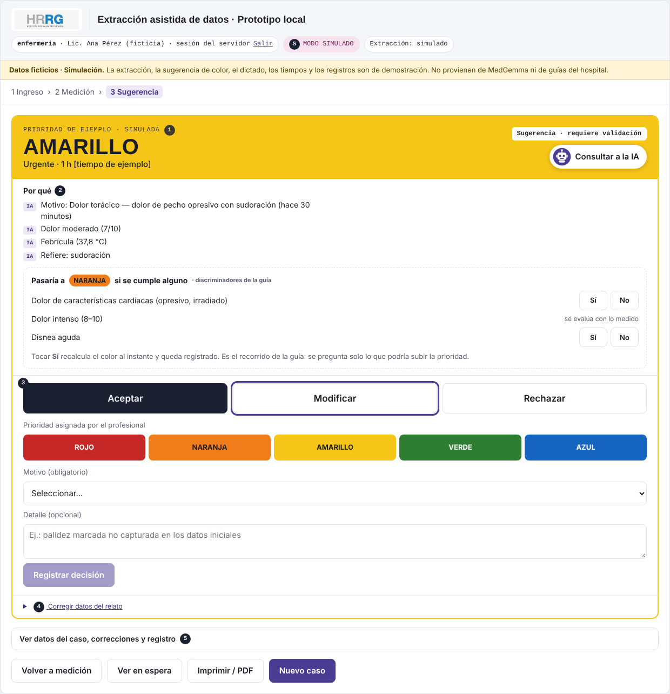

6. **Corregir datos del relato** (④): si la IA entendió algo mal, se corrige acá.
7. **Ver datos del caso, correcciones y registro** (⑤): muestra el resumen con el origen de cada dato y el registro (fecha, usuario, decisión).
8. Los botones de abajo:
   - **Volver a medición**
   - **Ver en espera**
   - **Imprimir / PDF**
   - **Nuevo caso**: limpia todo para el próximo paciente.

---

## 5. Pacientes en espera

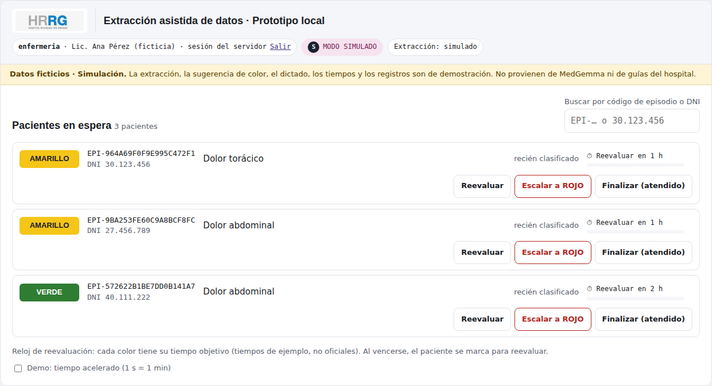

**La lista:**
- Están todos los pacientes ya clasificados, **ordenados por color** (primero el más grave) y por tiempo de espera.
- Cada fila muestra el color, el **código de episodio** (EPI-…), el DNI, el motivo, cuánto hace que espera, la **hora de ingreso** y la **hora del triage**.
- Si el paciente tiene una **condición especial** (por ejemplo *Custodia policial*), aparece como etiqueta gris. **No cambia su lugar en la fila.**
- La lista **se actualiza sola cada 30 segundos**: los minutos avanzan y aparecen los pacientes que cargó otra computadora, sin recargar la página.
- **Reloj de reevaluación:** cuenta el tiempo que queda según el color. Los tiempos los configura la Jefatura de Guardia (ver sección 8).
  - Cuando se vence, la fila se marca: *"Vencido hace… · reevaluar"*.
  - Si un paciente superó el tiempo de su color, aparece *"Superó X min"*.

**Qué se puede hacer con cada paciente:**

| Botón | Para qué |
|---|---|
| **Reevaluar** | Abre el mismo episodio con los datos anteriores para volver a medir. La tarjeta muestra *antes → ahora* y se guardan las dos versiones. |
| **Escalar a ROJO** | Para un deterioro en la espera, sin volver a cargar datos. Elegís el **motivo (obligatorio)**, un detalle opcional y tocás **Confirmar ROJO**. |
| **Finalizar (atendido)** | Saca al paciente de la lista cuando ya lo atendieron. Hay que tocar dos veces: **Finalizar** y después **Confirmar finalizar**. |

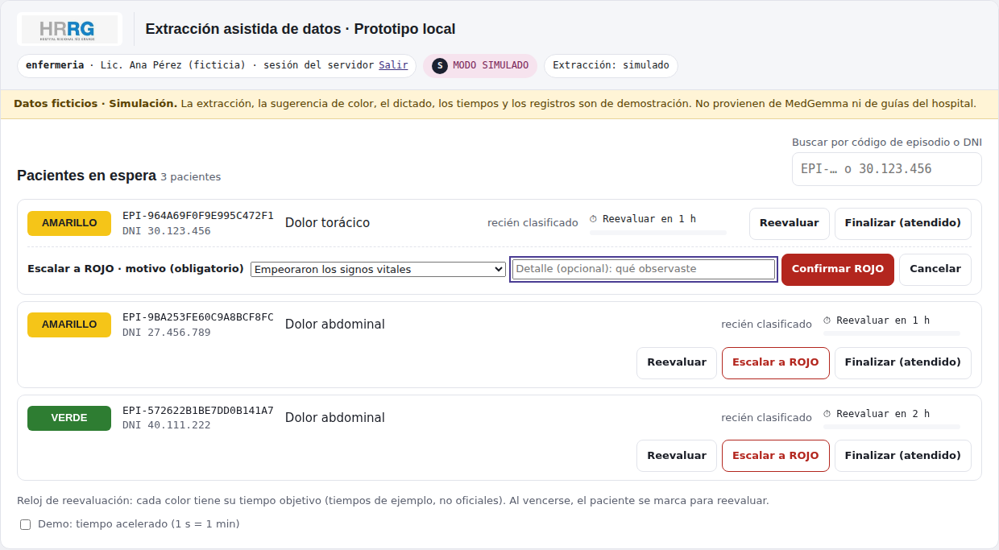

**Buscador** (arriba a la derecha):
- Escribí un **código de episodio** o un **DNI** (con o sin puntos).
- Desde 2 caracteres te **sugiere** coincidencias de lo que ya está en pantalla.

---

## 6. Lista de espera en la sala y en el celular

Es una pantalla **de consulta** para un televisor de la sala de espera, una tablet o el celular. Muestra la misma cola que **En espera** y se actualiza sola **cada 15 segundos**.

**Cómo se abre:**
- La PC donde corre el sistema y el celular o la tablet tienen que estar en la **misma red Wi-Fi**.
- En el navegador del celular hay que escribir `http://<IP de la PC>:5000/sala.html`, por ejemplo `http://192.168.100.71:5000/sala.html`.
- La IP de la PC y la configuración de la red las resuelve el área de informática.
- **Más fácil, con el código QR:** en **En espera** tocá **QR de la sala**. Se abre una página con un código QR que ya trae la dirección correcta (con la IP de la PC). Apuntá la cámara del celular al código y tocá el enlace. La página se puede **imprimir** para pegar en la sala.
  - Con la opción **Datos (JSON, para sistemas)**, el QR lleva al endpoint `/api/sala/espera` en lugar de a la pantalla.

| Vista pública · `sala.html` | Vista del personal · `sala.html?personal=1` |
|---|---|
| 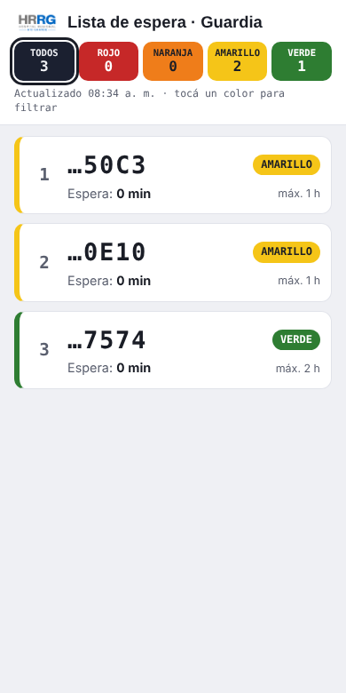 | 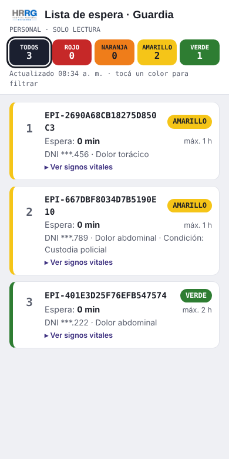 |

**Vista pública** (`sala.html`): la puede ver cualquiera, por eso **no tiene datos personales**.
- Solo muestra los **últimos 4 caracteres del episodio**, el **color** y **cuánto lleva esperando**.
- Cada tarjeta indica el tiempo máximo de su color. Si se pasó, el tiempo aparece en **rojo con ⚠**.
- Los botones de colores de arriba **filtran**: tocá **AMARILLO** y quedan solo esos. **TODOS** vuelve a mostrar la lista completa. El número de la izquierda sigue siendo el lugar en la fila general.

**Vista del personal** (`sala.html?personal=1`):
- Primero hay que **iniciar sesión** en ese mismo navegador (`http://<IP de la PC>:5000/`) con un usuario de Enfermería, Médico/a o Auditoría.
- Muestra además el **código de episodio completo**, el **DNI enmascarado** (`DNI ***.456`), el **motivo** y la **condición especial**, si tiene.

**En las dos vistas:**
- Son **solo lectura**. Reevaluar, escalar y finalizar se hacen en la PC, con usuario y registro.
- Los pacientes **sin color** (todavía no pasaron por el triage) **no aparecen**.
- Los tiempos máximos de cada color son los que configuró la Jefatura de Guardia.

**Para informática:** la misma lista está disponible en JSON, sin datos personales, en `GET /api/sala/espera`, para mostrarla en otras pantallas. Ver `docs/endpoints_externos.md`.

---

## 7. Auditoría

El perfil Auditoría es **solo lectura**: no ve los botones para cargar, reevaluar, escalar ni finalizar.

### Ver el historial de un paciente en espera

- En cada fila, **Ver historial** muestra todo lo que pasó con ese episodio: datos de ingreso, mediciones, correcciones, decisiones y motivos.
- Si buscás un **DNI completo** (7 u 8 números), aparecen **todas las atenciones** de esa persona, incluidas las finalizadas, y el botón **Exportar este paciente**.

### Historial de casos

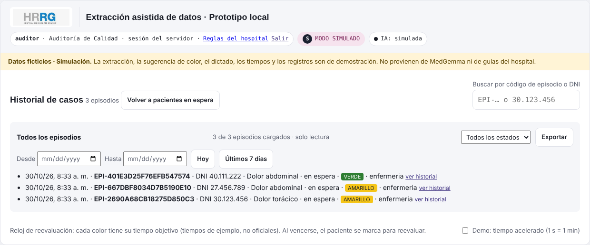

Tocá **Historial de casos**. El título cambia y la lista de espera se oculta. Para salir, **Volver a pacientes en espera**.

**Cómo filtrar:**
- **Estado:** todos, en ingreso, en espera o finalizados.
- **Fechas:** **Desde** / **Hasta**, o los atajos **Hoy** y **Últimos 7 días**. **Quitar fechas** limpia el filtro.
- **Buscador:**
  - Con un **DNI completo**, trae **todas las atenciones de esa persona**.
  - Con un código EPI o parte de un DNI, filtra entre los casos cargados.

**Otros botones:**
- **Ver más** carga los siguientes 50 casos.
- **ver historial** abre el detalle de cada caso.

### Exportar a Excel o PDF

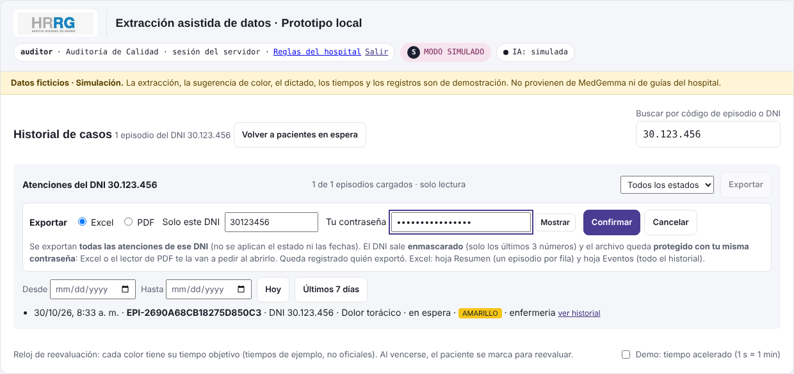

1. Tocá **Exportar**.
2. Elegí **Excel** o **PDF**.
3. **Solo este DNI** (opcional):
   - **Vacío:** exporta **todos** los casos del estado y las fechas elegidos.
   - **Con un DNI:** exporta **todas las atenciones de esa persona**, sin importar el estado ni las fechas.
   - Si llegaste buscando un DNI, ya viene cargado.
4. **Tu contraseña:** la misma con la que entrás. Se pide de nuevo por seguridad. **Mostrar** deja ver lo que escribiste.
5. Tocá **Confirmar**. El archivo se descarga en la carpeta **Descargas**.

**Seguridad del archivo:**
- El DNI sale **enmascarado**: solo se ven los últimos 3 números (`••.•••.456`).
- El archivo queda **protegido con tu contraseña**: Excel o el lector de PDF te la van a pedir **al abrirlo**.
- Queda registrado **quién exportó, cuándo y qué**.
- Con **3 contraseñas incorrectas** se bloquea la exportación hasta que cierres sesión y vuelvas a entrar.

**Qué trae cada formato:**
- **Excel:** una hoja **Resumen** (un caso por fila, con la **condición especial**), una hoja **Eventos** (todo el historial de cada caso) y una hoja **Info** (filtros usados, quién exportó y cuándo).
- **PDF:** una tabla resumen y el historial de cada atención.

> Los archivos exportados son para uso del auditor. No los compartas ni los guardes en carpetas públicas.

**Para informática:** otro sistema autorizado puede consultar esta misma información (búsqueda de casos, historial y exportación) por la **API de auditoría**, con un token propio. Ver `docs/endpoints_externos.md`.

---

## 8. Reglas del hospital (Jefatura de Guardia)

Los criterios clínicos **no están escritos en el programa**: son reglas guardadas en la base de datos que administra la **Jefatura de Guardia** (perfil *Jefatura de Guardia*) en la pantalla **Reglas del hospital**. Auditoría las puede ver en solo lectura, desde el enlace *Reglas del hospital* del encabezado.

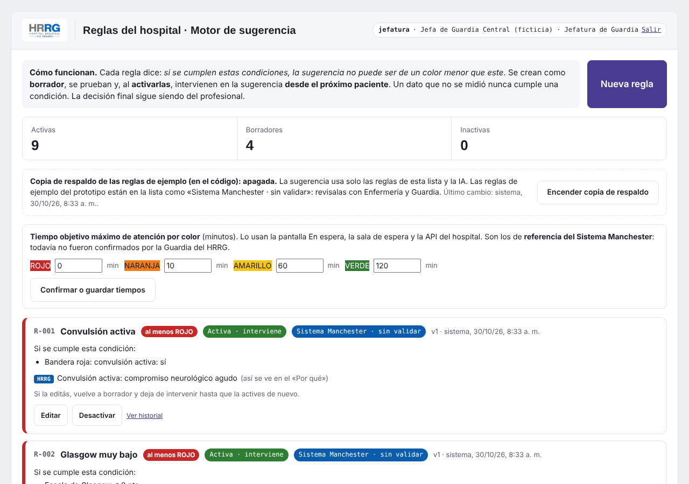

**Qué hay en la pantalla, de arriba hacia abajo:**
- **Contadores:** reglas activas, borradores e inactivas.
- **Copia de respaldo de las reglas de ejemplo:** las reglas de seguridad del prototipo ya están cargadas en la lista. Esta copia escrita en el programa queda **apagada** y solo se enciende como respaldo.
- **Tiempo objetivo máximo de atención por color** (ver abajo).
- **La lista de reglas.**

**Las reglas que vienen cargadas:**
- **9 reglas activas** de origen *Sistema Manchester* (convulsión, Glasgow bajo, compromiso respiratorio, sangrado, dolor intenso, etc.), **sin validar**.
- **4 reglas en borrador** propuestas por el HRRG (fiebre, cefalea, fiebre en lactante y dolor torácico). **No intervienen** hasta que la Jefatura complete sus valores y las active.

**Cómo funciona una regla:**
- Dice: *si se cumplen estas condiciones, la sugerencia no puede ser de un color menor que este*. Por ejemplo: *si SpO₂ < 94 % y tiene antecedente respiratorio → como mínimo NARANJA*.
- Un dato que **no se midió nunca cumple** una condición: la regla no adivina.
- Las reglas activas intervienen **desde el próximo paciente**, sin reiniciar nada.
- La decisión final sigue siendo del profesional, que puede modificar el color con un motivo.

**Cada regla muestra:**
- su **código** (R-001…), color mínimo y estado;
- su **origen**: *Sistema Manchester*, *Adaptación local HRRG* o *Provisoria / en revisión*;
- **quién la validó y cuándo**, o *sin validar*;
- el **discriminador** o criterio clínico que la respalda, si se cargó.

**Crear una regla:**
1. Tocá **Nueva regla**.
2. Escribí un **nombre corto** y elegí el **color mínimo**.
3. Completá el **origen**, **validada por** (el profesional o servicio que la aprobó; la fecha se registra sola) y, si querés, el **discriminador** que la respalda.
4. Agregá las **condiciones** (hasta 8): el dato, la comparación y el valor.
   - Datos disponibles: signos vitales, conciencia, dolor, edad, **grupo etario** (lactante, niño, adolescente, adulto, adulto mayor: se calcula solo con la edad), sexo, categoría del motivo, banderas rojas y antecedentes.
   - Con más de una condición, elegí si se tienen que cumplir **todas** o alcanza con **alguna**.
5. Escribí la **explicación para el profesional**: es lo que va a leer en el «Por qué».
6. Debajo se lee la regla en una frase. En **Probar con un caso de ejemplo** cargá valores y fijate si la regla se cumple.
7. Tocá **Guardar como borrador**. Un borrador **todavía no interviene**.

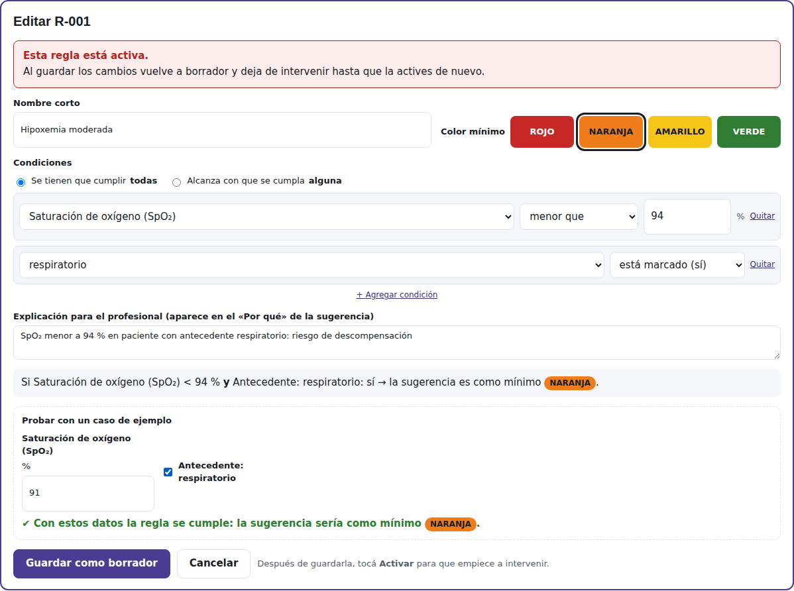

**Estados de una regla:**

| Estado | Qué significa | Qué se puede hacer |
|---|---|---|
| **Borrador** | Está guardada pero no interviene | Editar, **Activar**, Eliminar (si nunca estuvo activa) |
| **Activa** | Interviene en la sugerencia | Editar (vuelve a borrador), **Desactivar** |
| **Inactiva** | Ya no interviene; se conserva para el registro | Editar, **Activar** |

- **Activar**, **Desactivar** y **Eliminar** piden un segundo toque para confirmar.
- **Editar una regla activa la vuelve a borrador** y sube su versión (v1, v2…). Hay que activarla de nuevo.
- **Ver historial** muestra quién la creó, editó, activó o desactivó, y cuándo.

### Tiempos objetivo por color

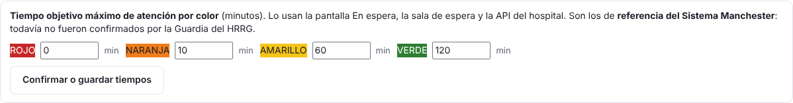

- Son los minutos máximos de espera de cada color. Los usan **En espera**, la **sala de espera** y la **API del hospital**.
- Vienen con los valores de **referencia del Sistema Manchester**. La Jefatura los revisa y toca **Confirmar o guardar tiempos**; desde ahí figura quién los guardó y cuándo.

## 9. Administración de usuarios

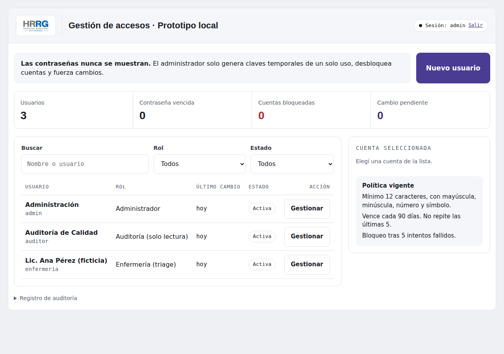

- **Contadores de arriba:** usuarios, contraseñas vencidas, cuentas bloqueadas y cambios pendientes.
- **Nuevo usuario:** nombre del profesional, usuario y perfil. Los perfiles son Enfermería, Médico/a, Auditoría, **Jefatura de Guardia** (administra las reglas del hospital) y Administración.
- **Buscar, Rol y Estado:** filtran la lista de cuentas.
- **Gestionar** una cuenta:
  - **Desbloquear cuenta**, si se pasó de los 5 intentos.
  - **Restablecer contraseña:** genera una **clave temporal** que vale 24, 4 o 1 hora y **se muestra una sola vez**. El profesional la cambia en su próximo ingreso.
  - **Cambiar el rol o desactivar la cuenta.** Tu propia cuenta no se puede cambiar ni desactivar.
- **Registro de auditoría:** quién hizo cada cambio sobre las cuentas.

> **Las contraseñas nunca se muestran**, ni siquiera a Administración.

---

## 10. Colores y tiempos de referencia

> Son los tiempos de **referencia del Sistema Manchester**. La Jefatura de Guardia los puede cambiar en **Reglas del hospital** (sección 8).

| Color | Prioridad | Tiempo objetivo |
|---|---|---|
| 🔴 **ROJO** | Inmediata | Atención inmediata |
| 🟠 **NARANJA** | Muy urgente | 10 min |
| 🟡 **AMARILLO** | Urgente | 60 min |
| 🟢 **VERDE** | Normal | 120 min |

**Casos policiales, judiciales o con custodia:** no llevan un color aparte. Se registran como **Condición especial** en el paso 1 y conservan su color clínico.

---

## 11. Problemas frecuentes

| Qué pasa | Qué hacer |
|---|---|
| "Usuario o contraseña incorrectos" | Revisá con **Mostrar** lo que escribiste. Después de 5 intentos la cuenta se bloquea: pedile a Administración que la desbloquee. |
| Me olvidé la contraseña | Administración te genera una **clave temporal**. Al entrar con ella, el sistema te pide una nueva. |
| La extracción tarda mucho | Con MedGemma, la primera consulta puede tardar 1 o 2 minutos. El cartel "Sigue procesando…" es normal. |
| La IA no responde | Seguí con **Clasificar sin IA**: el triage no depende de la IA. |
| "Los datos de la exportación no son válidos" | El servidor quedó con una versión vieja. Cerrá la ventana del servidor y volvé a abrir `iniciar_con_ia.bat`. |
| "Exportación bloqueada" | Pusiste mal la contraseña 3 veces. Cerrá sesión (**Salir**) y volvé a entrar. |
| No puedo abrir el Excel o el PDF exportado | Te pide **tu** contraseña, la misma con la que entrás al sistema. |
| El celular no abre `sala.html` | La PC y el celular tienen que estar en la misma red Wi-Fi, y la red tiene que permitir que los equipos se vean entre sí. Las redes de invitados suelen bloquearlo: consultá con informática. |
| La pantalla de la sala dice "Sin conexión con el servidor" | Se cortó la red o se cerró el servidor. Mientras tanto se muestran los últimos datos; cuando vuelve la conexión, se actualiza sola. |
| La pantalla se ve vieja o rara | Apretá **Ctrl+F5** en el navegador. |
| Me sacó al inicio de sesión | Si dice *"La sesión se cerró por inactividad"*, pasaron 15 minutos sin uso. Volvé a ingresar. |
| Volví a Ingreso y la pantalla está en blanco | Es así a propósito después de registrar la decisión: el caso ya está en **En espera**. Para cambiarlo, usá **Reevaluar**. |
| Un paciente con custodia no pasó adelante en la fila | Es así a propósito: la condición especial no cambia la prioridad clínica. La fila se ordena por color y tiempo de espera. |
| Activé una regla y no cambió la sugerencia | La regla se aplica desde el **próximo** "Pedir sugerencia". Revisá que esté **Activa** (no en borrador) y que el caso tenga cargados todos los datos de sus condiciones. |

---

*Cómo instalar y levantar el sistema: ver `README.md`. Conexión con otros sistemas (para informática): `docs/api_hospital.md` y `docs/endpoints_externos.md`. Detalle técnico de cada pantalla: `docs/frontend_cambios.md` y `docs/contrato_api.md`.*
